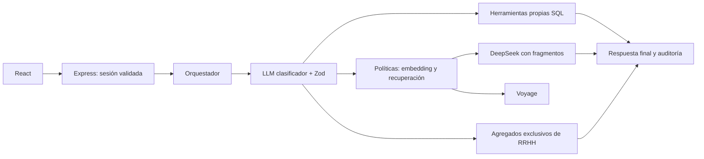

# Evidencia técnica del portal

Fecha de revisión: 2026-11-18. Empresa y personas ficticias. Este documento describe el código y las pruebas efectivamente ejecutadas; no certifica un despliegue público ni sustituye los informes académicos de extensión requerida.

## Flujo de una pregunta

La identidad procede de una cookie aleatoria cuya huella SHA-256 se guarda en `sesiones`. La consulta de autenticación verifica usuario y colaborador activos y vencimiento. El rol de un mensaje no altera el de la sesión. Los métodos de datos reciben el objeto validado y parametrizan su `colaborador_id`. Las rutas de RRHH aplican una segunda comprobación explícita del rol.

El clasificador solo puede seleccionar seis intenciones. Zod rechaza respuestas fuera del esquema y el backend deriva los destinos desde una lista fija. No hay SQL libre ni nombres de herramientas ejecutables enviados por el modelo. Las negativas más evidentes se resuelven antes del LLM; las otras decisiones quedan acotadas por permisos de las herramientas, aunque la clasificación falle. Para una pregunta mixta, las ramas de política y datos se ejecutan en paralelo después del enrutamiento.

Los datos propios se redactan con plantillas desde SQL. El asistente maneja saldo, siguiente fecha de pago para el grupo de planilla, próxima evaluación y solicitudes por fecha, incluida la resolución del viernes en el reloj local. Cuando existen varias solicitudes y falta la fecha, pide precisión.

La tabla `consultas_chat` recibe una fila por pregunta completa. `intervenciones` conserva evidencias, duración, escalamiento y errores por agente. La intención y tema utilizan taxonomías fijas. El estado final y latencia se registran incluso ante fallos; las métricas de chat no se calculan contando cada agente como una pregunta.

## Corpus y trazabilidad

`DRIVE_FOLDER_ID` define el alcance. La sincronización captura el token de cambios antes del barrido inicial, recorre descendientes con paginación y reconcilia el inventario frente al índice. Un archivo fuera de alcance o sin aprobación se retira de futuras búsquedas; un fallo transitorio del proveedor revierte la sincronización sin borrar el corpus. Un 404 comprobado del alcance retira sus documentos. Los errores quedan registrados con códigos, sin persistir secretos de proveedores.

Se aceptan Google Docs, Sheets, PDF con texto, DOCX y archivos de texto. La exportación CSV de Sheets cubre la primera pestaña. No hay OCR. El contenido se divide por títulos o encabezados numerados, con un máximo inicial de 2800 caracteres y solapamiento de 350. Estos valores son puntos iniciales para evaluación, no tamaños óptimos demostrados.

Los embeddings se validan como vectores finitos de 1024 dimensiones antes de modificar fragmentos. El reemplazo usa la misma conexión transaccional y un savepoint por documento. Si falla una escritura después de borrar fragmentos, el savepoint restablece la versión anterior. Si falla cualquier documento, el token no avanza: el siguiente intento puede reprocesarlo. La versión remota se verifica otra vez antes de publicar el índice.

La recuperación filtra documentos aprobados y vigentes, modelo y dimensión. El ranking exacto por coseno ocurre en Node para el corpus reducido. El umbral configurable no se interpreta como probabilidad de verdad. El LLM devuelve suficiencia e IDs de fragmentos; la aplicación valida que todos existan en el contexto recuperado. Si falta sustento, devuelve abstención sin citas inventadas. Cada fuente conserva ID de documento, fragmento, título, sección, versión y enlace real.

El historial pertenece exclusivamente a la identidad autenticada. Al consultar una conversación se verifica su propietario y se filtran fuentes retiradas. Una respuesta cuya fuente perdió autorización se sustituye por un aviso para realizar una consulta actualizada. No se abre acceso a documentos mediante URLs fabricadas.

## Cálculos del reporte

El corte se fija a las 07:00 de `America/Costa_Rica`, equivalentes a las 13:00 UTC en este escenario. Los tests usan el 17 de noviembre de 2026 y la ejecución habitual usa el reloj actual.

| Métrica | Método implementado |
| --- | --- |
| Ausentes | Unión de incapacidades y solicitudes aprobadas que cubren la fecha, por persona distinta activa a esa fecha |
| Desglose | `ROW_NUMBER` selecciona incapacidad, vacaciones o permiso; los registros superpuestos generan incidencia |
| Pendientes | Creación anterior o igual al corte, resolución posterior o estado pendiente sin resolución |
| Antiguas | `creada_en < corte - 72 horas`, con comparación estricta |
| Incapacidades del mes | CTE de días desde el primer día al corte y `COUNT(DISTINCT persona,día)` |
| Rotación | `100 * salidas / ((personal_inicio + personal_corte)/2)`; sin denominador produce null |
| Vacaciones en riesgo | Saldo consolidado actual estrictamente mayor a 20; no representa un pasivo monetario |
| Chat de ayer | Intervalo semiabierto de medianoche local a medianoche local |
| Resuelto sin escalar | Completadas resueltas y no escaladas / completadas; denominador cero produce null |
| p90 | Rango más próximo, posición `ceil(0.90*n)` sobre una latencia por pregunta |

Las tablas de origen y decisiones de cálculo se almacenan dentro del JSON del reporte. Este JSON proviene exclusivamente de SQL. El modelo recibe agregados y produce de tres a cinco frases estructuradas; las cifras deben coincidir con hechos permitidos, los números nuevos se rechazan y no se admiten tendencias sin comparación. Tras dos intentos inválidos se usa una plantilla y se conserva `LLM_NO_VALIDADO` junto al método. La revisión semántica del resumen sigue siendo parte de la evaluación real.

La clave primaria de `reportes_diarios.fecha` y el bloqueo de fila serializan disparos simultáneos. Las llamadas repetidas reutilizan el reporte y registran un evento de auditoría. Los reportes terminados no se reescriben al cambiar los datos de origen. Un fallo revierte el reporte y registra una ejecución fallida.

## Automatización y dashboard

El proceso de API verifica el horario cada minuto, con una guarda que evita superposición dentro del proceso. Al reiniciar recupera como máximo treinta fechas posteriores al último reporte completo. Una instalación sin reportes solo genera el último corte. La automatización requiere mantener la API en ejecución.

El dashboard está disponible únicamente para RRHH y muestra al menos cuatro indicadores, gráfico de treinta días, barras por departamento, tabla de solicitudes pendientes, métricas del chat, resumen e historial descargable. El gráfico histórico se calcula desde hechos SQL; no se insertan reportes ficticios para aparentar ejecuciones pasadas. La alerta de saldo se identifica como actual porque el esquema no contiene snapshots históricos de saldos.

## Evidencia ejecutada

Se aplicaron migraciones aditivas contra MySQL real y se conservaron 251 colaboradores ficticios. El fixture existente contiene el saldo de doce días del colaborador principal y las fechas de solicitud y evaluación del banco. `seed:history` agregó datos identificados de septiembre, octubre y noviembre y calendarios, con una marca de versión para no duplicarlos.

`npm test` pasó veintiocho pruebas unitarias. `npm run test:integration` pasó la prueba principal y cuatro grupos de verificación, contra una base temporal independiente. Se verificaron específicamente:

- Corte exacto de 72 horas y reconstrucción de una solicitud resuelta después del corte.
- Incapacidades que cruzan meses y periodos superpuestos, sin días duplicados.
- Rotación y chat sin denominador; promedio y p90 con límites de medianoche.
- Dos disparos simultáneos que generan una sola fila de reporte y dos eventos de auditoría.
- 403 en todos los endpoints RRHH para un colaborador y 404 en historial ajeno.
- Ignorar rol e identidad del cuerpo; negativas obligatorias a saldo de un compañero y salario del gerente.
- Usuarios inactivos rechazados incluso con una sesión previamente válida.
- Drive paginado simulado: creación, cambio, conservación de índice y token ante fallo de embeddings, retiro y ausencia de borrado por error transitorio.

`npm run build` compiló la interfaz. La sesión no expone un navegador controlable, por lo que no se presenta la compilación como revisión visual.

## Evaluación real pendiente y operación

El ejecutor conserva las cuarenta y cinco preguntas originales y usa usuarios reales del seed con el reloj fijado a 2026-11-17. Guarda respuesta, citas y latencia por pregunta, condiciones, modelo, umbral y huella del corpus. Las filas exitosas quedan pendientes de revisión; no se marcan correctas por completar una llamada. El resumen exige al menos 36/45, 20/25 de base, preguntas 21 y 22 seguras y p90 menor a 8000 ms, con al menos 41 de 45 bajo ese umbral.

El usuario autorizó expresamente el corpus ficticio para Voyage y DeepSeek, y después autorizó los agregados ficticios para el resumen. La ingesta real terminó con doce documentos y cincuenta y tres fragmentos, sin errores ni omitidos. Una consulta posterior contrastó versiones y enlaces con Drive. Las versiones de política se extrajeron del texto (1.0) y se distinguen de la revisión de Drive. La cuenta conectada tiene permisos de lectura, sin capacidad para editar ni agregar archivos.

La corrida completa revisada obtuvo **41/45**, **22/25** en la base, sin fuga en las negativas obligatorias 21 y 22, p90 de **5028 ms** y las cuarenta y cinco respuestas por debajo de ocho segundos. Se usó concurrencia uno con intervalo mínimo de llegadas de veintiún segundos por la cuota observada; no es una prueba de ráfaga HTTP. El código medido y los cuatro errores (9, 19, 25 y 38) permanecen archivados. La revisión es asistida por Codex y no se presenta como certificación docente.

Posteriormente se añadieron controles generales para pago propio, composición mixta y agregado RRHH, y se corrigieron caracteres de una plantilla. Las pruebas dirigidas 9, 19, 25 y 44 pasaron **4/4**. Esos resultados no sustituyen las filas ni generan una puntuación nueva de cuarenta y cinco preguntas para la versión posterior. El traslado de una condición de capacitación a cumpleaños permanece documentado como error de calidad de la muestra. La evaluación sobre el banco conocido no demuestra generalización a preguntas nuevas.

El resumen del reporte de hoy se verificó con DeepSeek y se comprobó por hash que su redacción no modificara el JSON SQL. Tras corregir fechas incoherentes del seed, se conservó la instantánea previa del reporte y se regeneró con motivo y auditoría. El fixture principal conserva saldo, solicitudes y fechas esperadas. La API y Vite quedaron funcionando en localhost, con comprobaciones de login, datos propios, dashboard e historial a través del proxy real.

El sistema no calcula salarios individuales, no registra diagnósticos, no envía denuncias ni crea tickets. Los contactos `.example` son ficticios. Los archivos originales no se declaran normativa empresarial real aprobada. La investigación jurídica y los informes finales deben distinguir notas aportadas, verificaciones realizadas y resultados aún no ejecutados.

## Referencias de implementación

- [Drive: cambios](https://developers.google.com/workspace/drive/api/guides/manage-changes).
- [Drive: descarga y exportación](https://developers.google.com/workspace/drive/api/guides/manage-downloads).
- [Formatos exportables de Workspace](https://developers.google.com/workspace/drive/api/guides/ref-export-formats).
- Fuentes oficiales del escenario: `guias_rrhh/fuentes_oficiales.json` y referencias de cada política aportada.
